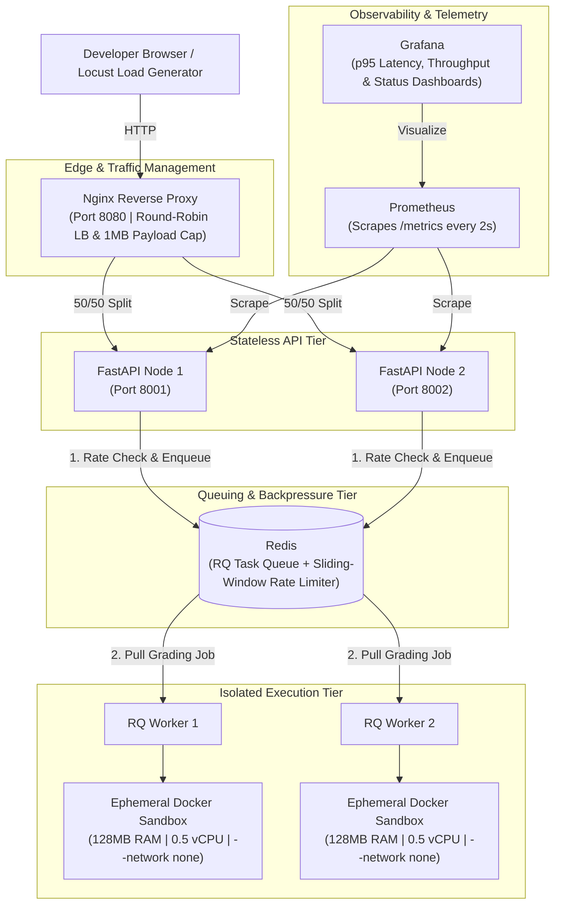
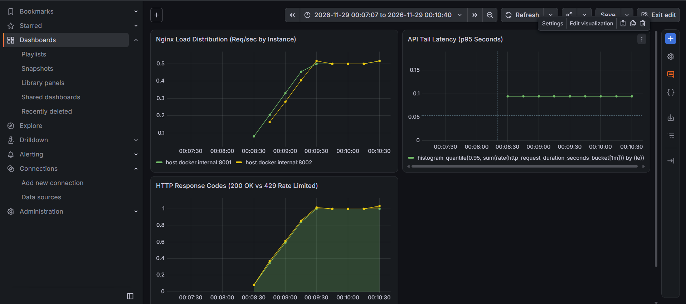

# RepoDrill — Distributed Multi-File Codebase Assessment & Sandboxed Execution Engine

**RepoDrill** is a multi-file coding practice and evaluation platform designed to simulate real-world software engineering workflows—**fixing broken repositories**, **debugging production error logs**, and **implementing features** inside unfamiliar codebases. 

Rather than focusing purely on frontend/backend CRUD, this project was engineered as a deep dive into **Non-Functional Requirements (NFRs)**, **distributed systems architecture**, **container security**, and **real-time observability** under concurrent user load.

---

## System Architecture



---

## Core Non-Functional Requirements (NFRs) & Engineering Decisions

### 1. Scalability & Asynchronous Load Leveling (FastAPI + Redis + RQ)
* **Problem**: Executing `pytest` and `ruff` inside Docker containers takes `~350–500ms` per submission. Running Docker synchronously inside HTTP request handlers blocks worker threads and causes cascading timeouts under burst traffic.
* **Solution**: Decoupled HTTP ingestion from sandbox execution using a **Redis + RQ** Producer-Consumer queue. FastAPI validates payloads, enqueues a job ticket, and returns a `job_id` in **<15ms**, while stateless background workers pull and grade submissions asynchronously.
* **Horizontal Scaling**: Because API nodes hold zero local state, **Nginx** load-balances traffic evenly (`50/50`) across multiple FastAPI instances (`8001` and `8002`), while multiple worker processes scale container throughput independently.

### 2. Multi-Tenant Security & Blast-Radius Containment (Docker Hardening)
* **Problem**: Executing untrusted user code exposes the host machine to infinite loops, memory bombs, data exfiltration, and directory traversal attacks.
* **Solution**:
  * **Network Isolation**: Containers run with `network_disabled=True` (`--network none`), blocking external network calls and reverse shells.
  * **Resource Cgroups**: Enforced hard caps (`128MB` RAM, `0.5` vCPU) per container so runaway processes cannot starve the host OS.
  * **Ephemeral Workspaces**: Submissions are merged into isolated `tempfile.TemporaryDirectory()` mounts inside self-destructing containers (`remove=True`), wiping all artifacts immediately after grading.
  * **Path Traversal Sanitization**: Canonical path resolution (`target.resolve()`) verifies all submitted file paths stay strictly inside the sandbox directory.

### 3. Resilience & Edge Backpressure (Nginx + Redis Rate Limiting)
* **Problem**: Rapid-fire submissions from a single client can flood the Redis queue and starve legitimate users.
* **Solution**: Configured **Nginx** at the edge to enforce strict request body limits (`1MB`) and timeouts, backed by an atomic **Redis Sliding-Window Rate Limiter** (`HTTP 429 Too Many Requests`) using Redis pipelines (`ZREMRANGEBYSCORE`, `ZCARD`, `ZADD`).

### 4. Real-Time Observability & Load Testing (Prometheus + Grafana + Locust)
* **Problem**: Identifying bottlenecks requires measuring time spent across network routing, queue wait times, and container cold-starts separately.
* **Solution**: Instrumented FastAPI with `prometheus-fastapi-instrumentator`, scraped metrics every `2s` with **Prometheus**, visualized live telemetry in **Grafana**, and stress-tested concurrent submission bursts with **Locust**.

---

## Load Testing & Observability Results



### Key Measured Observations
* **Even Load Distribution**: Grafana confirmed **Nginx** splits incoming requests symmetrically (`~0.5 req/s` per instance across ports `8001` and `8002`) with zero uneven routing.
* **Predictable Tail Latency (`p95`)**: Decoupling Docker execution behind Redis kept API ingestion `p95` latency flat at **`~95ms`** under sustained load, eliminating HTTP thread starvation.
* **Zero Error Leakage (`0%` 5xx Rate)**: All valid requests resolved cleanly with `HTTP 200`, while excess traffic above the configured threshold was cleanly shed at the API layer with `HTTP 429`.
* **Worker-to-vCPU Trade-off**: Scaling from `1` to `3` parallel RQ workers significantly reduced `queue_wait_ms` under concurrent Locust bursts, whereas scaling beyond host vCPU limits introduced CPU context-switching overhead in `docker_exec_ms`.

---

## Tech Stack
* **Frontend**: React, Vite, JavaScript/TypeScript
* **API & Workers**: Python 3.11, FastAPI, Pydantic, RQ (Redis Queue)
* **Sandbox & Linting**: Docker Engine, Python Docker SDK, Pytest, Ruff
* **Infrastructure & Edge**: Nginx, Redis, Docker Compose
* **Observability & Load Testing**: Prometheus, Grafana, Locust

---

## Local Setup & Running the Distributed Cluster

### 1. Build the Isolated Sandbox Image
```bash
cd backend
docker build -f Dockerfile.sandbox -t repo-sandbox:latest .
```

### 2. Start Infrastructure (Redis, Nginx, Prometheus, Grafana)
```bash
cd infra
docker compose up -d
```

### 3. Start Stateless FastAPI Nodes & Sandbox Workers
Open separate terminals inside `backend/`:
```bash
# Terminal 1 (API Node 1)
uvicorn app.main:app --port 8001

# Terminal 2 (API Node 2)
uvicorn app.main:app --port 8002

# Terminal 3 & 4 (Parallel Sandbox Workers)
python worker.py
```

### 4. Start Frontend & Run Locust Load Tests
```bash
# Frontend (http://localhost:5173)
cd frontend && npm run dev

# Locust Load Generator (http://localhost:8089)
cd loadtest && locust -f locustfile.py --host http://localhost:8080
```